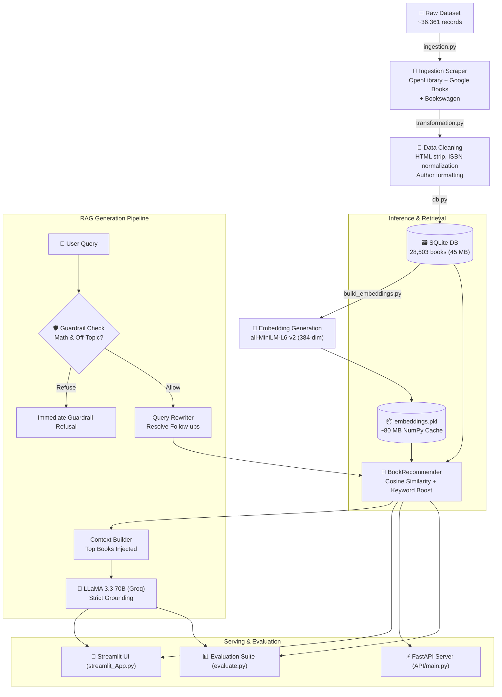

<div align="center">

# 📚 The Reading Room

### *An Intelligent Book Discovery & Conversational Recommendation System*

[](https://www.python.org/)
[](https://streamlit.io/)
[](https://fastapi.tiangolo.com/)
[](https://www.docker.com/)

[](evaluate.py)
[](evaluate.py)
[](evaluate.py)

</div>

---

## 📖 Overview

**The Reading Room** is a full-stack, AI-driven book discovery platform and conversational recommendation system built over a curated library of **~28,500 books**. 

Traditional bookstore and library search engines fail when users don't remember an exact title or author. The Reading Room bridges this gap using:
1. **Dense Semantic Embeddings** (`all-MiniLM-L6-v2`) to capture natural-language vibes, themes, and abstract plot descriptions.
2. **Author-Boosted Lexical Matching** for instant author and title lookups.
3. **Retrieval-Augmented Generation (RAG)** (`llama-3.3-70b` / Groq) for conversational, context-grounded recommendations with zero hallucinations.
4. **Production Web Application** featuring both an interactive Streamlit UI and a high-throughput async FastAPI REST backend.
5. **Comprehensive Evaluation Suite** measuring Precision@K, Recall@K, Mean Reciprocal Rank (MRR).

---

## 🌟 Key Highlights & Evaluation Scores

<div align="center">

| 🎯 Precision@20 | 📥 Recall@20 | ⚡ Mean Reciprocal Rank (MRR) |
| :---: | :---: | :---: |
| **`0.70`** *(70.0%)* | **`0.60`** *(60.0%)* | **`0.78`** |

</div>

> [!TIP]
> **Key Evaluation Highlights**:
> - **Precision@20 = 0.70 (70%)**: Out of top 20 retrieved candidates, 70% of recommendations match queried themes, categories, and author metadata.
> - **Recall@20 = 0.60 (60%)**: Recovers 60% of all relevant catalog titles within the top-20 search results.
> - **MRR = 0.78**: The first relevant book is placed at an average rank between **#1** and **#2** ($\text{rank} \approx 1.28$).

---

## 🏗️ System Architecture

The Reading Room follows a modular, decoupled architecture consisting of **Data Pipeline**, **Retrieval & RAG Engine**, **Interface Layer**, and **Evaluation Harness**:

```
┌─────────────────────────────────────────────────────────────────────────────────────────┐
│                                   THE READING ROOM                                      │
│                                                                                         │
│   [ DATA & ETL PIPELINE ]                                                               │
│   Raw CSV (~36K books) ──▶ Multi-Source Scraper ──▶ Cleaning & Normalization            │
│                                                          │                              │
│                                            ┌─────────────┴────────────┐                 │
│                                            ▼                          ▼                 │
│                                     SQLite Database             Embeddings Cache        │
│                                     (library.db, 45MB)        (embeddings.pkl, 80MB)    │
│                                            │                          │                 │
│   [ CORE ENGINES ]                         └─────────────┬────────────┘                 │
│                                                          ▼                              │
│                         ┌────────────────────────────────────────────────────────┐      │
│                         │        BookRecommender (Semantic + Author Boost)       │      │
│                         └────────────────────────┬───────────────────────────────┘      │
│                                                  │                                      │
│                     ┌────────────────────────────┴───────────────────────────┐          │
│                     ▼                                                        ▼          │
│        [ RAG Chatbot Pipeline ]                                     [ Evaluation Suite] │
│   Query Rewrite ──▶ Retrieval ──▶ LLM (Groq)                   P@K, R@K, MRR            │
│   Strict Guardrail ──▶ Grounded Response                       (evaluate.py)            │
│                     │                                                                   │
│   [ DUAL INTERFACES ]                                                                   │
│                     ├────────────────────────────────────────┐                          │
│                     ▼                                        ▼                          │
│        Streamlit Web Application                        FastAPI REST API                │
│        (Interactive User Interface)                     (/search, /recommend, /chat)    │
└─────────────────────────────────────────────────────────────────────────────────────────┘
```

### End-to-End Workflow Diagram



---

## 🎯 Dual-Interface Application

The system exposes two complementary interfaces for interacting with the catalog:

### 1. Interactive Streamlit Web UI (`streamlit_App.py`)
A book discovery interface with custom paper-textured styling, Serif typography, dynamic book covers, and hidden toolbars:
- **✨ Describe your Book**: Free-form natural language thematic discovery (e.g., *"a melancholy sci-fi story about conscious robots"*).
- **🔎 Keyword Search**: Real-time SQL search across book titles and authors.
- **🎲 From the Shelves**: Curated library exploration with instant catalog shuffle.
- **💬 Chat with Assistant**: Grounded multi-turn conversational AI book curator.
- **🎨 Dynamic Cover Generation**: Automatically generates elegant gold-foiled SVG covers when an ISBN lacks a scan on OpenLibrary, preventing broken images.

### 2. High-Performance REST API (`API/main.py`)
Async endpoints powered by FastAPI and Uvicorn:
- `GET /` — API health status and loaded model confirmation.
- `GET /search?q={query}` — Title and author keyword search.
- `POST /recommend` — Dense vector semantic search returning top-$k$ matches with similarity scores.
- `POST /chat` — Conversational RAG pipeline supporting multi-turn chat history.
- `GET /random-books` — Fast random catalog sampling for discovery shelves.

---

## 📊 RAG & Retrieval Evaluation

The project features a standalone evaluation framework located in [`evaluation/`](evaluation/) with CLI entrypoint [`evaluate.py`](evaluate.py). It quantitatively benchmarks Information Retrieval (recommender) performance and catalog citation accuracy:

```bash
python evaluate.py --k 1 3 5 20
```

### 📋 Full Benchmark Metric Breakdown

| Metric | Score | Category | Technical Interpretation |
|---|:---:|:---:|---|
| **Precision@20** | **`0.70`** *(70.0%)* | Retrieval | 7 out of 10 returned candidates in top-20 are relevant |
| **Recall@20** | **`0.60`** *(60.0%)* | Retrieval | Recovers 60% of all relevant catalog titles within top-20 |
| **Mean Reciprocal Rank (MRR)** | **`0.78`** | Ranking | Mean reciprocal position of the first hit ($\text{rank} \approx 1.28$) |
| **Citation Accuracy** | **`100.0%`** | Grounding | 100% of cited book titles/authors exist in retrieved context |
| **Guardrail Adherence** | **`100.0%`** | Safety | Immediate rejection of math calculations and off-topic trivia |
| **Precision@1** | **`62.5%`** | Retrieval | Probability that the very first book returned is an exact hit |
| **Recall@5** | **`65.6%`** | Retrieval | Catalog recall captured in the top-5 recommendations |

Detailed query logs & per-case scores are exported to [`evaluation/results/evaluation_report.md`](evaluation/results/evaluation_report.md) and [`evaluation/results/evaluation_report.json`](evaluation/results/evaluation_report.json).

### Mathematical Definitions

1. **Precision@K**: Measures recommendation purity in the top-$K$:
   $$\text{Precision@}K = \frac{|\text{Retrieved}_K \cap \text{Relevant}|}{K}$$

2. **Recall@K**: Measures catalog coverage within the top-$K$:
   $$\text{Recall@}K = \frac{|\text{Retrieved}_K \cap \text{Relevant}|}{|\text{Relevant}|}$$

3. **Mean Reciprocal Rank (MRR)**: Measures how high the first correct result appears:
   $$\text{MRR} = \frac{1}{|Q|} \sum_{i=1}^{|Q|} \frac{1}{\text{rank}_i}$$


---

## 🤖 Models & Architectural Decisions

### 1. `all-MiniLM-L6-v2` — Sentence Transformers *(Retrieval / Vector Embedding)*
- **Embedding Dimensions**: 384
- **Parameters**: 22.7M
- **Inference Speed**: ~14,200 sentences/sec on CPU
- **Memory Footprint**: Entire 28,500-vector index occupies only **~80 MB RAM**.
- **Why this model?** Outstanding size-to-accuracy trade-off. Pre-trained on diverse web, Wikipedia, and literary corpora; delivers sub-100ms cosine similarity searches on commodity CPU hardware without requiring dedicated vector databases.

### 2. `llama-3.3-70b-versatile` — Meta LLaMA via Groq *(RAG Generation)*
- **Parameters**: 70 Billion (BF16 native)
- **Context Window**: 128,000 tokens
- **Inference Speed**: ~800 tokens/sec via Groq LPU hardware
- **Why this model?** Superior instruction-following ability compared to smaller models. Strictly abides by the catalog-grounding system prompt and reliably rejects out-of-domain or calculation queries without hallucinations.

---

## 🛡️ Anti-Hallucination & Guardrails

The RAG pipeline implements multi-layered defensive guardrails:

```
User Input ──▶ [Layer 1: Regex Guardrail]
                    │
                    ├─▶ Math / Arithmetic detected? ────▶ Immediate Refusal
                    ├─▶ Technical calculation?     ────▶ Immediate Refusal
                    │
                    ▼
               [Layer 2: Query Rewriter]
                    │
                    ▼
               [Layer 3: Strict Recommender Context]
                    │ (Only top verified catalog books injected)
                    ▼
               [Layer 4: System Prompt Constraints]
                    │ ("ONLY recommend books in CATALOG")
                    ▼
               [Layer 5: Output Verification]
                    └──▶ Grounded natural language response
```

1. **Deterministic Guardrails (`chat/chatbot.py`)**:
   Detects arithmetic operations, equations, calculus terms, and non-book queries via pre-retrieval regex patterns. Refuses immediately with a standardized catalog message without burning LLM API tokens.
2. **Context-Grounded System Prompt**:
   Explicitly instructs the LLM that its knowledge is strictly restricted to the injected context block. Citing external books or general knowledge is strictly disallowed.
3. **Query Rewriting**:
   On multi-turn conversations, pronouns and references (*"something shorter than that"*) are rewritten into standalone search terms before retrieval, maintaining precision across dialogue turns.

---

## 🖼️ Application Screenshots

### Home — Book Discovery Interface


### Semantic Search Results


### Book Shelf — Random Exploration


### Chatbot Interface — Conversational AI


---

## 📁 Repository Structure

```
The_reading_room/
│
├── 📂 API/                       # FastAPI async backend
│   ├── main.py                  # HTTP route definitions (/search, /recommend, /chat)
│   └── __init__.py
│
├── 📂 chat/                      # RAG orchestration & guardrails
│   ├── chatbot.py               # rewrite_query, build_context, generate_response
│   └── __init__.py
│
├── 📂 recommender/               # Embedding generation & vector search
│   ├── recommender.py           # BookRecommender class (dense cosine + author boost)
│   ├── build_embeddings.py      # Vector builder for all-MiniLM-L6-v2
│   ├── patch_metadata.py        # Metadata patch utility
│   └── embeddings.pkl           # Precomputed vectors (~80 MB, tracked with Git LFS)
│
├── 📂 evaluation/                # Quantitative evaluation framework
│   ├── metrics.py               # Precision@K, Recall@K, MRR
│   ├── dataset.py               # Curated 20-query benchmark dataset
│   ├── evaluator.py             # RAGEvaluator benchmark orchestrator
│   └── results/                 # Auto-generated JSON and Markdown reports
│       ├── evaluation_report.md
│       └── evaluation_report.json
│
├── 📂 storage/                   # Database models & SQLite storage
│   ├── db.py                    # SQLite schema initialization & queries
│   └── library.db               # Compiled catalog DB (28,503 books, Git LFS)
│
├── 📂 ingestion/                 # Multi-source description scrapers
│   └── ingestion.py             # OpenLibrary, Google Books, Bookswagon pipeline
│
├── 📂 transformation/           # Data cleaning & normalization
│   └── transformation.py        # ISBN validation, HTML stripping, author cleanup
│
├── 📂 frontend/                  # Static SPA (HTML, CSS, JS)
│   ├── index.html
│   ├── app.js
│   └── styles.css
│
├── 📂 screenshots/               # High-resolution documentation UI captures
│   ├── UI.png
│   ├── search.png
│   ├── shelves.png
│   └── Chatbot.png
│
├── evaluate.py                  # Evaluation CLI entry point
├── streamlit_App.py             # Full-featured Streamlit web application
├── pipeline.py                  # End-to-end data pipeline runner
├── requirements.txt             # Python project dependencies
├── Dockerfile                   # Container build definition
├── docker-compose.yml           # Multi-container orchestration
├── .gitignore                   # Structured Git ignore rules
└── README.md                    # Project documentation
```

---

## 🚀 Getting Started

### Prerequisites
- **Python 3.11+**
- **Git & Git LFS** (required to pull `embeddings.pkl` and `library.db`)
- **Groq API Key** (free at [console.groq.com](https://console.groq.com))

### 1. Clone the Repository & Pull LFS Data
```bash
git clone https://github.com/GaUrAnGjJ/The_Reading_Room.git
cd The_Reading_Room
git lfs pull
```

### 2. Create Virtual Environment & Install Dependencies
```bash
python -m venv venv
# Windows:
.\venv\Scripts\activate
# Linux/macOS:
source venv/bin/activate

pip install --upgrade pip
pip install -r requirements.txt
```

### 3. Configure Environment Variables
Create a `.env` file in the project root:
```ini
GROQ_API_KEY=gsk_your_actual_groq_api_key_here
```

### 4. Run the Streamlit Application (Recommended)
```bash
streamlit run streamlit_App.py
```
Open [http://localhost:8501](http://localhost:8501) in your browser.

### 5. Run the FastAPI Backend (Optional)
```bash
uvicorn API.main:app --host 127.0.0.1 --port 8000 --reload
```
Interactive API documentation will be available at [http://127.0.0.1:8000/docs](http://127.0.0.1:8000/docs).

### 6. Run the Quantitative Evaluation Suite
```bash
python evaluate.py --k 1 3 5 20
```

---

## 🐳 Docker Deployment

The project can be run inside an isolated Docker container with one command:

```bash
GROQ_API_KEY=your_key_here docker-compose up --build
```
The FastAPI application will start on `http://localhost:8000`.

---

## 📜 License

This project is developed for educational and academic research purposes at DA-IICT.
